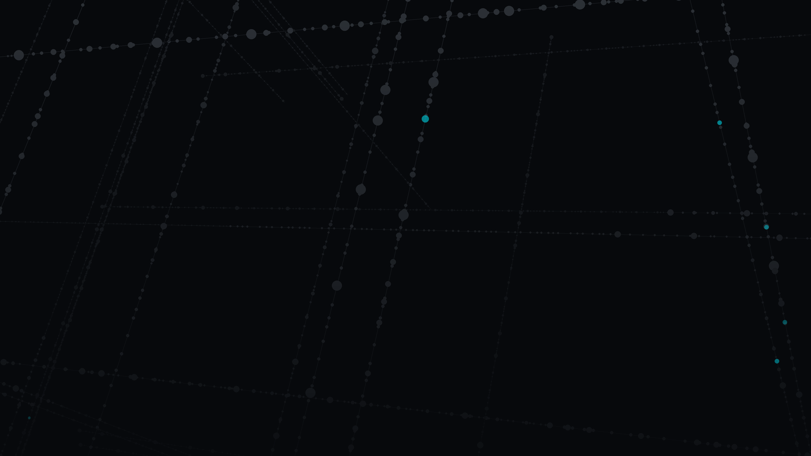

# dotfiles

Hyprland on EndeavourOS as a **company-issued workstation from a few decades out**: corporate
sci-fi. Flat engineered panels with hairline rules, header plates with an accent stripe,
tracked capital labels and asset codes, a brand mark, the company network behind everything.
Three themes (night, concrete, lab); only the colour changes.



Design rules: [`theme/DESIGN.md`](theme/DESIGN.md) · colours and contrast:
[`theme/PALETTE.md`](theme/PALETTE.md) · every key: [`docs/KEYS.md`](docs/KEYS.md)

## Install

### During the EndeavourOS install

1. Boot the EndeavourOS USB. In the live session open a terminal and run:
   ```bash
   curl -fsSL -o ~/user_commands.bash https://raw.githubusercontent.com/UncCodes/dotfiles/main/user_commands.bash
   ```
2. Start the installer, choose **Online**, pick **No Desktop**.
3. At the end the installer runs the script inside the new system: packages, links, zsh.
4. Reboot, log in on the console, and Hyprland starts. Then run `fui setup all` for the
   graphics driver, audio, Bluetooth, firmware, system services and Firefox.

### On an existing install

```bash
bash <(curl -fsSL https://raw.githubusercontent.com/UncCodes/dotfiles/main/install.sh)
```

Safe to run again: each step reports ok / skip / FAIL, a failed step doesn't stop the rest,
and anything it would overwrite is moved to `~/.dotfiles-backup/<timestamp>/` first.
Options: `--no-packages`, `--no-hardware`, `--no-chsh`, `--ci`. Package lists:
[`packages.txt`](packages.txt) (official repos), [`aur.txt`](aur.txt) (AUR, via yay),
[`stow.txt`](stow.txt) (folders linked into `$HOME`).

### Updating

```bash
fui update
```

## The `fui` command

One command runs the desktop's moving parts. `fui help` lists it all.

| Command | Does |
|---|---|
| `fui mode toggle` | cycle the theme: night → concrete → lab (`SUPER+SHIFT+T`, or click it in the bar) |
| `fui wallpaper toggle` | the network backdrop live (data packets travelling) or still (`SUPER+SHIFT+W`) |
| `fui screen toggle` | the screen finish (a faint vignette) on / off (`SUPER+SHIFT+C`) |
| `fui sound on` / `off` | the interface cues |
| `fui brand` | the company: name, division, motto (`[brand]` in `tokens.toml`) |
| `fui palette` | every action in one window (`SUPER+Space`) |
| `fui power` · `fui keys` · `fui clipboard` | power menu (`SUPER+X`), the key list (`SUPER+/`), clipboard history (`SUPER+SHIFT+V`) |
| `fui shot region` / `screen` / `edit` | screenshots, saved and copied (`Print`, `SHIFT+Print`, `SUPER+Print` to annotate) |
| `fui record toggle` | screen recording to `~/Videos/Recordings` (`SUPER+R`; the bar shows `● rec`) |
| `fui tabs` · `fui layout` | the startup terminal tabs · the startup layout |
| `fui update` · `fui updates` | update the dotfiles · count pending package updates (also in the bar) |
| `fui version` · `fui rollback [version]` | the installed version · go back to an earlier one if an update misbehaves (`fui update` returns to the newest) |
| `fui doctor` / `--fix` | check graphics, audio, network, packages, fonts, links, the look; fix what it can |
| `fui setup gpu` / `audio` / `bluetooth` / `firmware` / `system` / `firefox` / `boot` / `all` | machine setup (`boot`: the splash and the consoles; not part of `all`) |

When something looks wrong, run `fui doctor` and send its output.

## What it covers

| Area | What you get |
|---|---|
| Windows | flat panels, radius 6, a hairline edge (the focused one in the accent), no shadows; dialogs, pickers and small tools float centred; picture-in-picture pinned |
| Bar | the status rail: the brand badge, workspace segments `01 02 03`, the focused window, labelled telemetry, now playing, updates, recording, the theme, notices, the clock |
| Launcher | apps, the command palette, the session menu, the key reference, clipboard, emoji, calculator: one directory panel |
| Notices | memo cards with a stripe by urgency; the system console (`SUPER+N`) with do-not-disturb, toggles, volume and media |
| Volume / brightness | a small plate with a slim accent level |
| Lock screen | employee authentication: the company, a large clock, operator and node, a passphrase field, the logging notice |
| Apps | GTK3, GTK4 / libadwaita and Qt6 in all three themes, including apps installed later |
| Terminal | a night console in every theme; zsh, starship, fastfetch (the workstation's asset sheet with the mark), btop, Neovim, git colours on the same palette |
| Terminal tools | yazi, lazygit, wiremix, nmtui, gdu, nvtop, cava, tealdeer, glow, zoxide |
| Browser | Firefox with a flat tab strip and accent details; the start page is the company intranet |
| Apps by default | zathura (PDF), imv (images), mpv (video), satty (annotation), Thunar (files) |
| Sound | crisp synthetic cues as a sound theme: the sign-in arpeggio, notice tones, ticks, alerts |
| Boot | a Plymouth splash (the masthead over the network, a slim progress line), the console palette and a sign-in banner |
| System | keyring, firewall, weekly package-cache cleanup, firmware updates, the right graphics driver |

## Startup

At login: the theme, the wallpaper, the bar, notifications, the OSD, the login chime, a hidden
dropdown terminal (`SUPER+\``) and the startup layout,
[`fui/.config/fui/layout.conf`](fui/.config/fui/layout.conf), one app per line:

```
1  fui tabs      # workspace 1: the terminal tabs (SHELL, FILES, GIT, SYS)
2  firefox
```

The tabs are listed in [`kitty/.config/kitty/startup.session`](kitty/.config/kitty/startup.session).
Machine-only versions go in `layout.conf.local` and `startup.session.local` (ignored by git);
an empty one turns that part off.

## Theme system

Every visual value lives in [`theme/tokens.toml`](theme/tokens.toml). After editing:

```bash
python3 theme/build.py            # regenerate everything (and check contrast)
python3 theme/make-wallpaper.py --all   # redraw the three backdrops
python3 theme/make-sounds.py      # re-synthesise the sounds
python3 theme/make-brand.py       # redraw the brand mark
```

`build.py` writes one colour file per theme for each app (waybar, rofi, swaync, swayosd,
hyprlock, kitty's tab bar, Firefox), the whole GTK and Qt themes per theme, the fixed console
palette for everything on the terminal, fonts, the Hyprland token table, the screen finish,
the intranet start page and the docs. `fui mode` points each app's `fui-colors.*` link (and
the brand mark) at the current theme and reloads what's running. The network is a seeded
3D lattice ([`theme/lattice.py`](theme/lattice.py)); the mark is drawn by
[`theme/make-brand.py`](theme/make-brand.py).

Not reachable by a theme: apps that draw their own UI (Blender, games). They still get the
window frame, fonts and the dark / light preference.

## Testing

Every push runs [`.github/workflows/check.yml`](.github/workflows/check.yml) in a fresh Arch
Linux container: shellcheck and luacheck, the theme build and contrast check, a check that
every needed file is in git, a full `install.sh --ci`, Hyprland's own `--verify-config`, all
three theme switches, the key list, fonts, sounds, the boot splash and Neovim. It then
screenshots the real apps in every theme (GTK, Qt, rofi, kitty, the start page and a headless
Hyprland session) and attaches them to the run as "preview".

## Per-machine settings

`~/.config/hypr/local.lua` is created by the installer and ignored by git: monitor layouts,
and the NVIDIA environment variables when an NVIDIA card is present (`fui setup gpu` installs
the driver).
