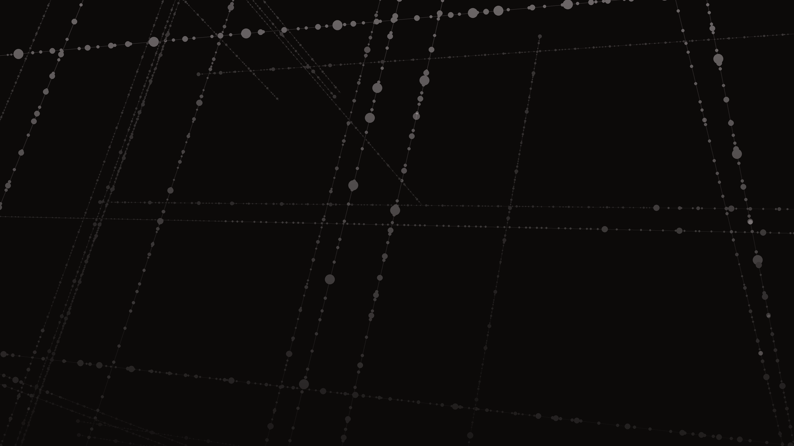

# dotfiles

Hyprland on EndeavourOS, dressed as [aljulandani.dev](https://aljulandani.dev): Y2K cybercore,
one person's computer from the 2000s web. Every surface is a window of frosted, glossy
plastic with a 1px bevel, a gel title bar and an inset well, over the site's network lattice
and old-screen glass. Three themes (dark, mid, light); only the colour changes.



Design rules: [`theme/DESIGN.md`](theme/DESIGN.md) · colours and contrast:
[`theme/PALETTE.md`](theme/PALETTE.md) · every key: [`docs/KEYS.md`](docs/KEYS.md)

## Install

### During the EndeavourOS install

1. Boot the EndeavourOS USB. In the live session open a terminal and run:
   ```bash
   curl -fsSL -o ~/user_commands.bash https://raw.githubusercontent.com/UncCodes/dotfiles/main/user_commands.bash
   ```
2. Start the installer, choose **Online**, pick **No Desktop**.
3. At the end the installer runs the script inside the new system: packages, links, zsh.
4. Reboot, log in on the console, and Hyprland starts. Then run `fui setup all` for the
   graphics driver, audio, Bluetooth, firmware, system services and Firefox.

### On an existing install

```bash
bash <(curl -fsSL https://raw.githubusercontent.com/UncCodes/dotfiles/main/install.sh)
```

Safe to run again: each step reports ok / skip / FAIL, a failed step doesn't stop the rest,
and anything it would overwrite is moved to `~/.dotfiles-backup/<timestamp>/` first.
Options: `--no-packages`, `--no-hardware`, `--no-chsh`, `--ci`. Package lists:
[`packages.txt`](packages.txt) (official repos), [`aur.txt`](aur.txt) (AUR, via yay),
[`stow.txt`](stow.txt) (folders linked into `$HOME`).

### Updating

```bash
fui update
```

## The `fui` command

One command runs the desktop's moving parts. `fui help` lists it all.

| Command | Does |
|---|---|
| `fui mode toggle` | cycle the theme: dark → mid → light (`SUPER+SHIFT+T`, or click it in the bar) |
| `fui wallpaper toggle` | the lattice live (beads travelling) or still (`SUPER+SHIFT+W`) |
| `fui screen toggle` | old-screen glass over the whole screen on / off (`SUPER+SHIFT+C`) |
| `fui sound on` / `off` | the interface sounds |
| `fui palette` | every action in one window (`SUPER+Space`) |
| `fui power` · `fui keys` · `fui clipboard` | power menu (`SUPER+X`), the key list (`SUPER+/`), clipboard history (`SUPER+SHIFT+V`) |
| `fui shot region` / `screen` / `edit` | screenshots, saved and copied (`Print`, `SHIFT+Print`, `SUPER+Print` to annotate) |
| `fui record toggle` | screen recording to `~/Videos/Recordings` (`SUPER+R`; the bar shows `● rec`) |
| `fui tabs` · `fui layout` | the startup terminal tabs · the startup layout |
| `fui update` · `fui updates` | update the dotfiles · count pending package updates (also in the bar) |
| `fui doctor` / `--fix` | check graphics, audio, network, packages, fonts, links, the look; fix what it can |
| `fui setup gpu` / `audio` / `bluetooth` / `firmware` / `system` / `firefox` / `boot` / `all` | machine setup (`boot`: the splash and the consoles; not part of `all`) |

When something looks wrong, run `fui doctor` and send its output.

## What it covers

| Area | What you get |
|---|---|
| Windows | frosted plastic, radius 10, the focused one edged in the theme's gel, no shadows; dialogs, pickers and small tools float centred; picture-in-picture pinned |
| Bar | the site's menubar strip: `@user`, white nav-button workspaces, the window's path, readouts, now playing, updates, recording, the theme switch, an LCD clock |
| Launcher | apps, the command palette, the power menu, the key list, clipboard, emoji, calculator: all one Aero window |
| Notifications | capsule windows; the control centre (`SUPER+N`) with do-not-disturb, toggles, volume and media |
| Volume / brightness | an on-screen capsule with an LCD level |
| Lock screen | a whoami window with an LCD clock |
| Apps | GTK3, GTK4 / libadwaita and Qt6 themed in all three themes, including apps installed later |
| Terminal | a dark CRT in every theme (the site's home terminal palette), tabs titled `[0x01] zsh`; zsh, starship, fastfetch, btop, Neovim, git colours on the same palette |
| Terminal tools | yazi, lazygit, wiremix, nmtui, gdu, nvtop, cava, tealdeer, glow, zoxide |
| Browser | Firefox with a gel tab strip and pill address bar; a start page of windows over the lattice |
| Apps by default | zathura (PDF), imv (images), mpv (video), satty (annotation), Thunar (files) |
| Sound | the site's synthesised interface sounds as a sound theme: login chime, notification bell, ticks, the theme glide |
| Boot | a Plymouth splash (the boot window with an LCD progress bar), the CRT palette and a banner on the consoles |
| System | keyring, firewall, weekly package-cache cleanup, firmware updates, the right graphics driver |

## Startup

At login: the theme, the wallpaper, the bar, notifications, the OSD, the login chime, a hidden
dropdown terminal (`SUPER+\``) and the startup layout,
[`fui/.config/fui/layout.conf`](fui/.config/fui/layout.conf), one app per line:

```
1  fui tabs      # workspace 1: the terminal tabs (SHELL, FILES, GIT, SYS)
2  firefox
```

The tabs are listed in [`kitty/.config/kitty/startup.session`](kitty/.config/kitty/startup.session).
Machine-only versions go in `layout.conf.local` and `startup.session.local` (ignored by git);
an empty one turns that part off.

## Theme system

Every visual value lives in [`theme/tokens.toml`](theme/tokens.toml). After editing:

```bash
python3 theme/build.py            # regenerate everything (and check contrast)
python3 theme/make-wallpaper.py --all   # redraw the three wallpapers
python3 theme/make-sounds.py      # re-synthesise the sounds
```

`build.py` writes one colour file per theme for each app (waybar, rofi, swaync, swayosd,
hyprlock, kitty's tab bar, Firefox), the whole GTK and Qt themes per theme, the fixed CRT
palette for everything on the terminal, fonts, the Hyprland token table, the screen shader,
the start page and the docs. `fui mode` points each app's `fui-colors.*` link at the current
theme and reloads what's running. The lattice is a port of the site's generator
([`theme/lattice.py`](theme/lattice.py), the same seeded drawing).

Not reachable by a theme: apps that draw their own UI (Blender, games). They still get the
window frame, fonts and the dark / light preference.

## Testing

Every push runs [`.github/workflows/check.yml`](.github/workflows/check.yml) in a fresh Arch
Linux container: shellcheck and luacheck, the theme build and contrast check, a check that
every needed file is in git, a full `install.sh --ci`, Hyprland's own `--verify-config`, all
three theme switches, the key list, fonts, sounds, the boot splash and Neovim. It then
screenshots the real apps in every theme (GTK, Qt, rofi, kitty, the start page and a headless
Hyprland session) and attaches them to the run as "preview".

## Per-machine settings

`~/.config/hypr/local.lua` is created by the installer and ignored by git: monitor layouts,
and the NVIDIA environment variables when an NVIDIA card is present (`fui setup gpu` installs
the driver).
